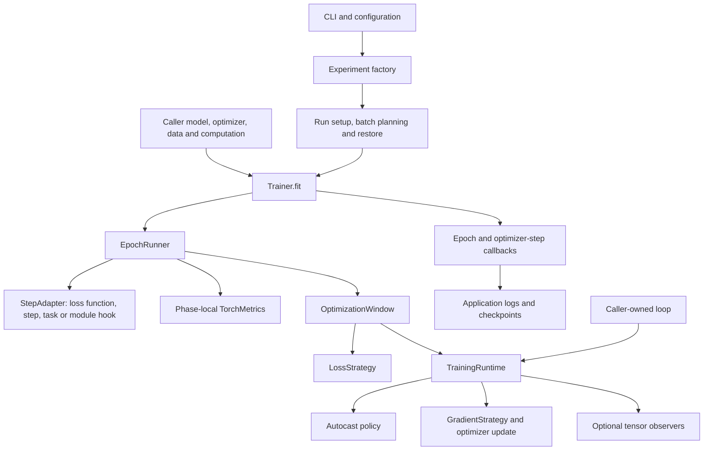

# Architecture and development

[Documentation index](../README.md) · [Training guide](../training/README.md) · [Examples](../../examples/README.md)

This guide is for changing DeepOpt. Training recipes can use the public APIs
without knowing the implementation layers below.
The [backend organization guide](backends.md) explains executor families,
operation directories, GEMM operands, and optional GPU imports.

## Responsibility boundaries



`Trainer` controls lifecycle and update timing around caller-supplied models
and loaders. It can construct an omitted optimizer and scheduler from resolved
configuration; supplied components remain caller-owned. Configuration resolution
is shared with the runtime and accepts dictionaries, typed settings, TOML paths,
and installed presets. The trainer does not construct datasets or models, or
choose artifact paths. Progress bars are optional in `fit()`, and lifecycle
events use the shared logger. File ownership and structured JSON/checkpoint
writes belong to the application layer and callbacks.

`TrainingRuntime` offers individual execution operations without epochs or
metric ownership. `OptimizationWindow` is an optional helper shared by the
automatic loop and manual recipes. Strategies decide loss normalization or
gradient processing; observers inspect tensors without changing computation.

`run.train()` adds reconstruction, batch-size planning, and artifact handling.
`memory/estimation.py` performs an isolated fake execution; it does not run as part of
every training update. `memory/planning.py` consumes those estimates and
applies supported loader changes before real training.

## Source map

Paths below are relative to the repository root. Package `__init__.py` files
collect selected exports; `__main__.py` enables `python -m deepopt`.

```text
src/deepopt/
├── engine/
│   ├── core.py         # Regular training core
│   ├── training/       # Trainer, epoch loops, step adapters and progress
│   ├── execution/      # Batch transfer, precision, backward and updates
│   ├── reporting/      # Metric accumulation, lifecycle and saved states
│   ├── checkpointing/  # Durable checkpoints and strategy state
│   └── strategies/     # Loss and gradient policies
├── distributed/        # Parent package of distributed cores
│   ├── ddp.py          # DDP core
│   └── _process.py     # Internal process-group helpers
├── cuda_graph/         # Independent graph capture/replay service
│   └── core.py         # CUDA Graph core, composed with either training core
├── opt/                # FX model transformation and optimized operations
│   ├── fx/             # Tracing, conversion registry, matching and rewriting
│   ├── nn/             # Projection modules, functional operations and autograd
│   │   ├── functional.py # Shared linear entry point and plan dispatch
│   │   └── autograd/   # Native/FP8 gradients and saved activations
│   ├── quantization/   # FP8 tensors, weight caches and activation codecs
│   ├── scaling/        # Current and delayed scaling state
│   └── backends/       # Execution backend dispatch and compatibility aliases
│       ├── reference/  # Reference GEMM implementation
│       ├── native/     # PyTorch scaled-FP8 GEMM
│       ├── _shared/    # Common CUDA launch helpers
│       └── triton/
│           ├── gemm/   # FP8 GEMM, launch planning and autotuning
│           ├── scaling/ # Amax reductions
│           └── quantization/ # FP8 casting and delayed-scale launches
│               └── activation/ # Affine 2-bit codecs and fused FP8 casts
├── scheduling/         # Pure curves, coefficient lifecycle and native LR factory
├── optimizer_factory.py # PyTorch/custom optimizer construction
├── optim.py            # Reserved optimizer algorithms; lazy legacy factory aliases
├── memory/             # Estimation, storage statistics and batch planning
├── data/               # Ordinary, skipping and resumable loading
├── tasks/              # Optional tasks and explicit loss metadata
├── optimizers/         # Optimizer composition
└── models/             # Bundled demonstration model
```

Public recipe modules such as `logger`, `config`, `run`, and `checkpoint` remain
at the package root. Internal modules use the categorized paths. Existing
`deepopt.engine.trainer`, `deepopt.engine.checkpoint`, and other former engine
imports remain aliases to the same implementations through `engine/_compat.py`.
Serialized engine class identities and logger namespaces are retained, so this
folder change does not invalidate existing checkpoints. `deepopt.memory` keeps
its public exports; its implementation is split among three focused modules.
The optimized-operation code follows the same rule: canonical implementations
live under `opt/nn`, `opt/scaling`, and the backend-specific packages. Former
private module paths remain compatibility aliases to the same module objects;
they do not contain duplicate implementations.

Tests are grouped by feature under `tests/`, and examples under `examples/`.
The progressive walkthrough stays at `examples/progressive_training.py`.
See [test groups](../../tests/README.md) and [examples](../../examples/README.md)
for focused commands. The usual recursive test discovery covers all groups.
Standalone measurements are grouped by workload in the
[benchmark catalog](../../benchmarks/README.md), with their contract tests in
[tests/benchmarks/](../../tests/benchmarks/).

| Area | Files and responsibilities |
| --- | --- |
| Packaging | [pyproject.toml](../../pyproject.toml): dependencies, `src` layout, `deepopt` console entry point |
| Public exports | [src/deepopt/__init__.py](../../src/deepopt/__init__.py): lazily load training APIs; configuration can be imported without loading Torch |
| CUDA Graphs | [cuda_graph/core.py](../../src/deepopt/cuda_graph/core.py): model/function capture, raw blocks and inference decorators; graph lifetime stays separate from training and DDP |
| Linear operations and model conversion | [opt/nn/functional.py](../../src/deepopt/opt/nn/functional.py) owns shared functional plan dispatch; [opt/policy.py](../../src/deepopt/opt/policy.py) builds plans; [opt/transform.py](../../src/deepopt/opt/transform.py) owns full/submodule FX orchestration; [opt/backends/](../../src/deepopt/opt/backends/) owns FP8 GEMM execution |
| FP8 execution | [triton/gemm/](../../src/deepopt/opt/backends/triton/gemm/) owns Triton GEMM and tuning; [native/fp8.py](../../src/deepopt/opt/backends/native/fp8.py) owns native scaled GEMM; [reference/gemm.py](../../src/deepopt/opt/backends/reference/gemm.py) provides emulation |
| Activation compression | [quantization/activation.py](../../src/deepopt/opt/quantization/activation.py) owns the payload and codec contract; [triton/quantization/activation/](../../src/deepopt/opt/backends/triton/quantization/activation/) owns CUDA kernels |
| Compilation | [engine/execution/compilation.py](../../src/deepopt/engine/execution/compilation.py): optional model-only compilation before DDP wrapping; runtime and optimizer remain eager |
| Application configuration | [config.py](../../src/deepopt/config.py): typed settings, strict common keys, application-owned metadata |
| Model storage summary | [memory/statistics.py](../../src/deepopt/memory/statistics.py): parameter counts/percentages, current storage and initialization logging without fake execution |
| Recipe callbacks | [checkpoint.py](../../src/deepopt/checkpoint.py): history, discovery and checkpoint files; [callbacks.py](../../src/deepopt/callbacks.py): scheduled update callbacks |
| Loader utilities | [data/skip.py](../../src/deepopt/data/skip.py): index-only sampler/loader skips; [data/stateful.py](../../src/deepopt/data/stateful.py): optional TorchData resume adapter |
| Logging | [logger.py](../../src/deepopt/logger.py): module loggers, scoped routing, configuration-derived files and command output |
| Entry points | [cli.py](../../src/deepopt/cli.py), [run.py](../../src/deepopt/run.py): command parsing, run setup, artifact callbacks and evaluation |
| Construction | [experiment.py](../../src/deepopt/experiment.py): connect factories; [baseline.py](../../src/deepopt/baseline.py): choices for the CLI demo |
| Device and reproducibility | [runtime.py](../../src/deepopt/runtime.py): resolve devices, seed Python/Torch, configure deterministic execution |
| Data | [data/loaders.py](../../src/deepopt/data/loaders.py): default loaders/generators; [data/resumable.py](../../src/deepopt/data/resumable.py): saved permutation and consumed cursor |
| Demo components | [data/synthetic.py](../../src/deepopt/data/synthetic.py), [models/mlp.py](../../src/deepopt/models/mlp.py): example data/model settings, independent of the core |
| Computation | [engine/training/steps.py](../../src/deepopt/engine/training/steps.py): normalize supported outputs and route metric inputs |
| Optional reuse | [module.py](../../src/deepopt/module.py), [tasks/base.py](../../src/deepopt/tasks/base.py), [classification.py](../../src/deepopt/tasks/classification.py), [regression.py](../../src/deepopt/tasks/regression.py): optional wrapper/protocol/presets |
| Loss metadata | [tasks/loss.py](../../src/deepopt/tasks/loss.py): `LossResult`, `LossReport`, weight validation |
| Lifecycle | [engine/training/trainer.py](../../src/deepopt/engine/training/trainer.py), [engine/training/loops.py](../../src/deepopt/engine/training/loops.py): fit/train/evaluate phases and callback boundaries |
| Runtime operations | [engine/execution/runtime.py](../../src/deepopt/engine/execution/runtime.py), [batch.py](../../src/deepopt/engine/execution/batch.py), [precision.py](../../src/deepopt/engine/execution/precision.py): transfer, backward, autocast and runtime health |
| Updates | [engine/execution/optimization.py](../../src/deepopt/engine/execution/optimization.py), [optimizer_step.py](../../src/deepopt/engine/execution/optimizer_step.py): accumulation, gradient processing and updates |
| Policies | [engine/strategies/](../../src/deepopt/engine/strategies/), [strategy_state.py](../../src/deepopt/engine/checkpointing/strategy_state.py): replaceable policies and checkpoint metadata |
| Optimizers | [optimizer_factory.py](../../src/deepopt/optimizer_factory.py) constructs optimizers; [optim.py](../../src/deepopt/optim.py) is reserved for algorithms; [optimizers/multi.py](../../src/deepopt/optimizers/multi.py) composes disjoint children |
| Scheduling | [scheduling/](../../src/deepopt/scheduling/) owns pure curves, coefficient values and native LR construction; Trainer owns timing; validation never advances schedules |
| Reporting | [engine/reporting/metrics.py](../../src/deepopt/engine/reporting/metrics.py), [metric_lifecycle.py](../../src/deepopt/engine/reporting/metric_lifecycle.py): phase-local accumulation and scalar output checks |
| Metric persistence | [engine/reporting/metric_state.py](../../src/deepopt/engine/reporting/metric_state.py): registered states, nested update counters and cache invalidation |
| Progress and checkpointing | [engine/training/state.py](../../src/deepopt/engine/training/state.py), [progress.py](../../src/deepopt/engine/training/progress.py), [checkpoint.py](../../src/deepopt/engine/checkpointing/checkpoint.py): durable state and restoration boundaries |
| Diagnostics | [observers.py](../../src/deepopt/observers.py): detached passive events and optional finite checks |
| Memory planning | [memory/estimation.py](../../src/deepopt/memory/estimation.py), [memory/planning.py](../../src/deepopt/memory/planning.py): tensor-storage estimates and fresh/resume batching |

## Where a new feature belongs

| Change | Start here |
| --- | --- |
| Different task, model, data format, or loss expression | A recipe in `examples/` or application code; use `step_fn` before adding an abstraction |
| Different optimizer construction or layer assignment | Caller optimizer factory; `MultiOptimizer` for disjoint child optimizers |
| Different accumulation weighting or gradient transformation | A loss/gradient strategy with explicit config and state |
| Arbitrary alternating/backward/update sequence | A manual loop using whichever runtime helpers are useful |
| New diagnostic tensor kind | An observer and an explicit `runtime.observe()` call or module hook |
| New worker/prefetch resume behavior | The loader's consumed-state implementation |
| Artifact naming, config parsing, external logging | The application layer or callbacks |
| Core scheduling or lifecycle behavior | Trainer/epoch runner, with a behavior-level regression test |

Persistent state belongs in registered model parameters/buffers, optimizer or
scheduler state, registered metric state, or strategy state. Arbitrary runtime
attributes, callback closures, observer state, datasets and Python function
bodies are not reconstructed by checkpoints.

## Configuration and lint maintenance

[src/deepopt/configs/](../../src/deepopt/configs) owns the built-in TOML presets
and complete template. Edit these sources, then regenerate the byte-identical
[configs/](../../configs) copies retained for existing checkout commands:

```bash
python scripts/sync_configs.py
python scripts/sync_configs.py --check
python -m ruff check src tests examples benchmarks scripts
```

The [sync script](../../scripts/sync_configs.py) works independently of the
current directory and does not import DeepOpt or PyTorch. `--check` is read-only
and fails on missing, different, or extra checkout TOML files. Normal sync
updates missing/different copies but leaves extra files untouched and reports
them for review. Store personal experiments elsewhere; generated copies are
overwritten by synchronization. The same workflow is included in source
distributions. Installed applications should use `builtin:NAME` or export their
own template; see [configuration inputs](../runs/README.md).

[pyproject.toml](../../pyproject.toml) owns the shared Ruff policy: syntax errors
(`E9`) and Pyflakes checks (`F`), including unused imports and variables. CI uses
the same command above. Intentional dependency probes and compatibility exports
should be explicit rather than removing necessary imports or suppressing entire
files. Formatting is separate from this lint policy.

## Tests and examples

Install the package in the environment you test. All commands run from the
repository root:

```bash
python -m unittest discover -s tests -v
python -m unittest discover -s tests -p 'test_step_checkpoint.py' -v
python -m unittest discover -s tests -p 'test_memory_estimation.py' -v
python examples/training/regression.py
python examples/checkpointing/checkpoint_resume.py --kind step
```

Tests cover actual parameter updates, loss/accumulation semantics, metric
routing, strategy replacement, observer failures, optimizer ownership, loader
positions, checkpoint compatibility, CLI workflows and memory-estimator
isolation. Exact-resume comparisons exclude timing measurements. CUDA tests
skip when hardware is unavailable; passing CPU tests does not validate GPU
allocations, bf16 kernels, or GPU throughput.

`test_checkpoint_generators.py` compares uninterrupted and resumed runs with
nested batch samplers. `test_getting_started.py` executes the published Python
walkthrough in order, including best-model evaluation, to catch notebook-state
and documentation regressions.

The `tests/distributed` group tests both execution cores, two-rank Gloo training,
torchrun launch, step/epoch recovery, and distributed memory planning. A CUDA/NCCL
variant requires two GPUs. An additional optional Gloo test isolates metric
synchronization. These checks require local process communication:

```bash
DEEPOPT_TEST_DISTRIBUTED=1 python -m unittest discover -s tests -p 'test_metrics.py' -v
```

See the [examples README](../../examples/README.md) for runnable commands and
which scripts create artifacts. The [CI workflow](../../.github/workflows/ci.yml)
runs lint, targeted typing, CPU tests and opt-in GPU checks.

## Autograd and performance

Losses remain differentiable through backward. Metric and observer inputs are
detached for reporting; detaching shares storage, so reporting code must not
modify those tensors in place. The epoch loop releases outputs before the next
forward pass. Metrics that retain predictions and user callbacks that keep
tensors can still increase memory usage.

Numerical checks add work, particularly for small models. Benchmark the actual
recipe before changing checks or accumulation. The bundled
[CPU benchmark](../../benchmarks/training/benchmark_training.py) compares a plain PyTorch
loop with the functional trainer on two fixed MLP workloads:

```bash
python benchmarks/training/benchmark_training.py --source src --profile --output work/perf-checks-on.json
python benchmarks/training/benchmark_training.py --source src --checks off --profile --output work/perf-checks-off.json
```

It uses one CPU thread, warmups, repeated median timings and identical initial
parameters/data. Setup and profiling are excluded from timed runs. Parameter
and loss comparisons must pass before performance comparisons are accepted.
Use `--batches`, `--warmups`, and `--repeats` to control workload duration;
`--source` can point at another local source snapshot. JSON includes environment
details, timings, correctness checks and optional operator counts.

Profiler allocation totals count repeated positive allocations; they are not
peak or retained memory. This benchmark does not measure GPU performance or
data-loader throughput. Fake-tensor [memory estimates](../memory/README.md)
serve a different purpose and do not replace measured workload validation.

## Supported boundaries

- `engine/core.py` owns regular single-process execution;
  `distributed/ddp.py` owns multi-rank DDP execution. The distributed package
  is the parent namespace for distributed cores. Both share runtime/trainer
  orchestration. For trainer-level AMP, CPU/CUDA support FP32 with AMP disabled,
  and CUDA additionally supports BF16 AMP. There is no FP16 AMP gradient scaler.
  Operation-level FP8 is owned by `opt/` below.
  See [DDP architecture and launch instructions](../distributed/README.md).
- The sibling `cuda_graph/core.py` owns CUDA capture/replay. Capture a model
  before constructing either training core; runtime/trainer state and DDP
  collectives remain eager. See [CUDA Graph APIs and tests](../cuda/README.md).
- `opt/` owns FX transformation, DO operations, FP8 saved-state autograd, and
  reference/Triton GEMM execution plus opt-in native scaled-GEMM backward.
  Pointer-free launch plans cache layout decisions while each call binds fresh
  descriptors; preparation owns projection exclusions and alias handling.
  Training/DDP cores stay independent of these
  operation implementations. See [FP8](../fp8/README.md) and
  [activation compression](../activation_compression/README.md). Sparse execution
  remains an extension point.
- Ordinary loaders are the default for epoch saving. Built-in index-skip
  sampler/loader utilities do not claim state recovery. The resumable loader
  supports rebatching and worker prefetch with a delivered-sample cursor;
  an optional TorchData adapter supplies fixed-batch worker-state resume.
  Custom loaders can implement the same
  consumed-data/prefetch contract. See [data loading](../data/README.md).
- Automatic optimizers must support `step()` without a closure; automatic
  schedulers must support `step()` without a required metric. Manual loops own
  other algorithms. Accumulation can differ from a larger batch for operations
  such as BatchNorm.
- Resume requires compatible components, data, settings and runtime versions.
  Batch-size changes preserve the supported loader's position, not its prior
  numerical trajectory. Checkpoint and failure guarantees are described in the
  [checkpoint guide](../checkpoints/README.md).
- Memory planning is shape/path-specific and uses private PyTorch fake-tensor
  interfaces. Unsupported tracing fails explicitly. CPU verification and an
  estimated fit are not evidence of GPU fit or deployment performance.

Generated runs, checkpoints, downloaded data, and local verification reports
belong in ignored locations such as `runs/`, `data/`, or `work/`. Keep examples
small and offline, and link the guide for any behavior they demonstrate.

Optional worker integration checks require the `workers` extra and a host that
permits PyTorch worker/tensor shared-memory services:

```bash
python -m pip install -e '.[workers]'
python -m unittest discover -s tests -p "test_stateful_loader.py" -v
```

The ordinary skip-loader tests also exercise real spawned workers with Python
batches, independently of tensor shared-memory services.
